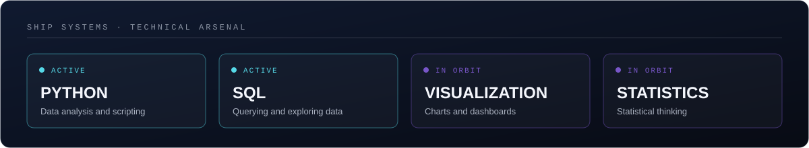
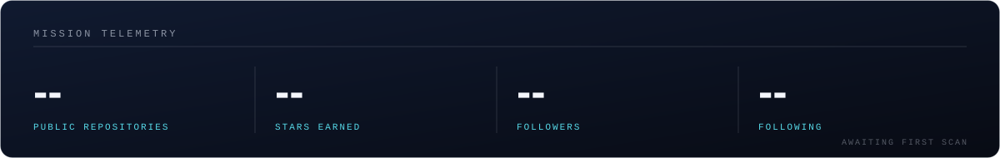
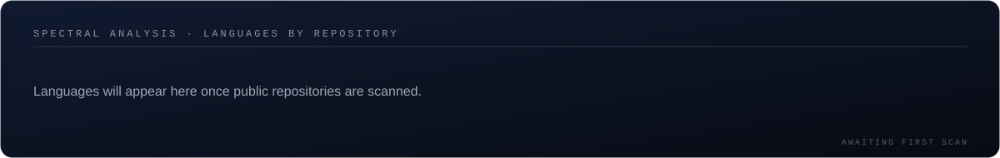
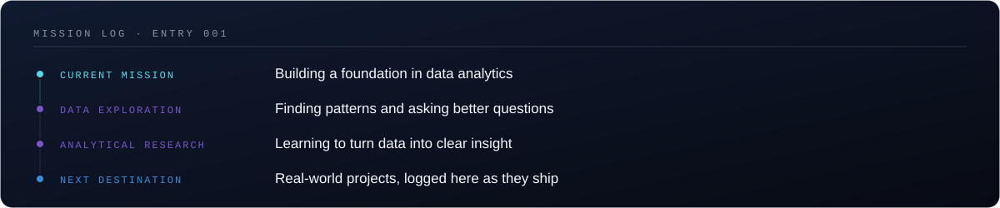

## `// 01 · ABOUT`

I'm Jayden, and I'm drawn to two kinds of vast, patterned things: the night sky and data. Both reward patience. A cluster of stars and a cluster of data points can look like noise until you find the right way to look at them.

I'm building my skills in **data analytics**: exploring datasets, asking better questions, and turning what I find into something people can understand and act on. Outside of that, I follow **space exploration and astronomy**, and I enjoy learning new tools and ideas as I go.

## `// 02 · TECHNICAL ARSENAL`

## `// 03 · GITHUB UNIVERSE`

## `// 04 · FEATURED PROJECTS`

New projects will be logged here as they launch. In the meantime, everything I'm building is in the [repositories tab](https://github.com/taker-rgb?tab=repositories).

<!--
Project card template. Replace REPO-NAME with a real repository, then un-comment:

**[REPO-NAME](https://github.com/taker-rgb/REPO-NAME)**: one-line description. `Python` `SQL`
-->

## `// 05 · MISSION LOG`

## `// 06 · CONNECT`

  
  <!--  -->
  <!--  -->

<i>Somewhere between data points and distant galaxies, discovery begins.</i>

