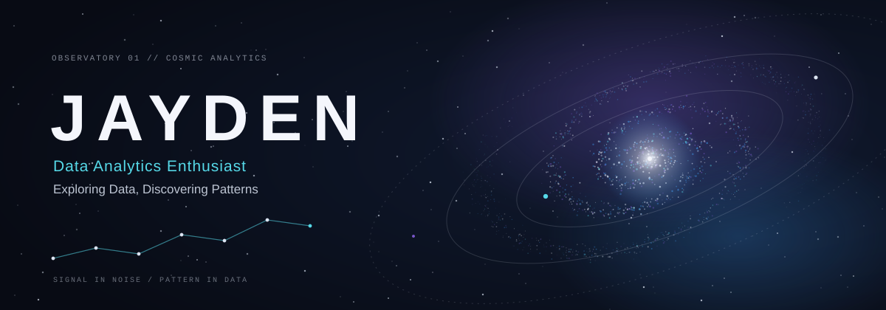
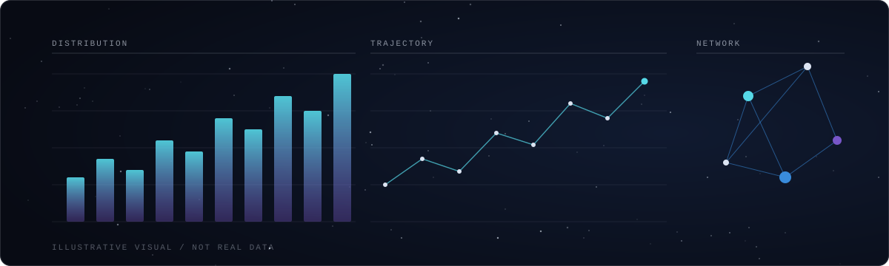
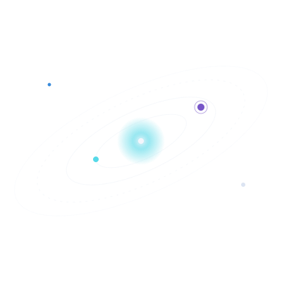

## `// 01 · ABOUT`

I'm Jayden, and I'm drawn to two kinds of vast, patterned things: the night sky and data. Both reward patience. A cluster of stars and a cluster of data points can look like noise until you find the right way to look at them.

I'm building my skills in **data analytics**: exploring datasets, asking better questions, and turning what I find into something people can understand and act on. Outside of that, I follow **space exploration and astronomy**, and I enjoy learning new tools and ideas as I go.

## `// 02 · TECHNICAL ARSENAL`

<table>
<tr>
<td width="50%" valign="top">

**DATA ANALYTICS**

</td>
<td width="50%" valign="top">

**IN ORBIT** *(learning)*

Data exploration · Visualization · Statistical thinking

</td>
</tr>
</table>

<!--
Add a badge here only once the skill is genuinely part of your toolkit, e.g.:

-->

## `// 03 · GITHUB UNIVERSE`

 

Stats are rendered by third-party services. If a card does not load, the service is temporarily unavailable; see the live numbers on the [GitHub profile](https://github.com/taker-rgb).

## `// 04 · FEATURED PROJECTS`

New projects will be logged here as they launch. In the meantime, everything I'm building is in the [repositories tab](https://github.com/taker-rgb?tab=repositories).

<!--
Project card template. Replace the values with a real repository:

-->

## `// 05 · MISSION LOG`

| | |
|:--|:--|
| **CURRENT MISSION** | Building a foundation in data analytics |
| **DATA EXPLORATION** | Finding patterns, asking better questions |
| **ANALYTICAL RESEARCH** | Learning how to turn data into clear insight |
| **NEXT DESTINATION** | Real-world projects, shared here as they ship |

## `// 06 · CONNECT`

  
  <!--  -->
  <!--  -->

<i>Somewhere between data points and distant galaxies, discovery begins.</i>

